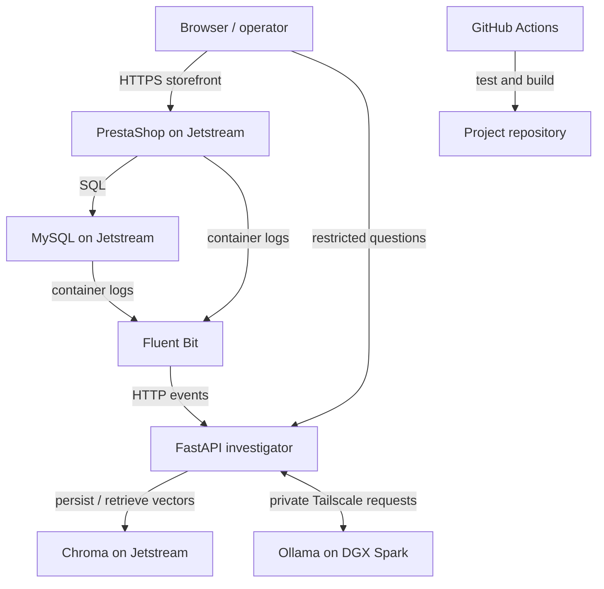

# Containerized RAG Log Investigator for an E-Commerce Application with Local AI Inference

> **Course:** Cloud Computing, DevOps, and AI  
> **Project type:** Individual educational project  
> **Status:** Planned  
> **Primary cloud environment:** Jetstream virtual machine  
> **Local inference environment:** DGX Spark running Ollama  
> **Last updated:** October 15, 2026

## 1. Project overview

This project will deploy an open-source PrestaShop e-commerce application and its MySQL database as Docker containers on a Jetstream virtual machine. Normal store activity—such as browsing products and placing synthetic test orders—and controlled failures will generate logs automatically. Fluent Bit will collect the container logs and forward them to a FastAPI log-investigator service. The service will preserve and index useful log events in Chroma, retrieve evidence relevant to a question, and ask a local model running through Ollama on a DGX Spark to explain what happened.

An operator will be able to ask questions such as **“Why did checkout fail?”** or **“What happened when the database restarted?”** The response should identify the likely cause and show the matching service, time, and log excerpts. It is a troubleshooting aid: it will not restart services or make changes automatically.

The Jetstream VM hosts the storefront, MySQL, Fluent Bit, FastAPI, and Chroma. The DGX Spark hosts Ollama and the chat and embedding models. Jetstream reaches Ollama through the private Tailscale network. Only the storefront is intended for public web access; database, vector store, Docker API, Ollama, and investigator access remain private or restricted.

## 2. Problem statement and motivation

An e-commerce request can involve several components: the browser, web application, database, log collector, and AI service. When an operation fails, the evidence may be spread across multiple service logs. A learner or operator has to identify which logs matter and connect events in time.

This project demonstrates a small, repeatable troubleshooting workflow: produce activity in a real application, collect its logs automatically, search the evidence, and ask a local AI model to explain the relevant events. It provides hands-on practice with Docker, cloud virtual machines, networking, log collection, APIs, vector retrieval, local model inference, testing, and CI.

## 3. Goals and success criteria

The project is successful when the following can be demonstrated and documented:

| Goal | Success evidence |
|---|---|
| Run a real e-commerce sample application | PrestaShop and MySQL start with Docker Compose, and a user can browse the store and place synthetic test orders. |
| Collect logs automatically | Fluent Bit forwards PrestaShop and MySQL container events to the investigator without manual log uploads. |
| Search logs with RAG | FastAPI retrieves relevant log evidence from Chroma for an investigator question. |
| Use local inference | Ollama on the DGX Spark supplies embeddings and generates an answer over Tailscale. Ollama is not exposed to the public internet. |
| Make answers inspectable | Answers include the source service, timestamp when available, and short supporting log excerpts; the service can say when evidence is insufficient. |
| Demonstrate controlled failures | At least three repeatable incidents are triggered and investigated, such as a database stop/restart, a web-container restart, and a test-only invalid database setting. |
| Test the software | Automated tests cover event normalization, filtering/redaction, retrieval behavior, and API responses. A documented set of about 20 questions is evaluated against known scenarios. |
| Practice DevOps | GitHub Actions runs checks and builds the project images. Deployment and recovery steps are documented and repeatable. |
| Protect the deployment | Only necessary storefront traffic is public; administrative access is restricted; secrets and real payment data are not committed or indexed. |

Evaluation measures include whether an answer identifies the known scenario, whether the cited events support the explanation, whether the model avoids unsupported claims, and response time. These are evaluation targets, not guaranteed accuracy or latency claims.

## 4. Minimum viable product and scope

### In scope

- One PrestaShop instance and one MySQL database.
- Docker Compose for local development and the Jetstream deployment.
- Fluent Bit tailing the relevant Docker container logs and forwarding events automatically to FastAPI.
- A small FastAPI service with an ingest endpoint, a basic restricted question interface or API, event normalization, and retrieval logic.
- Chroma as a persistent vector index for searchable log chunks.
- Ollama on the DGX Spark for the embedding model and chat model, reached over Tailscale.
- A small, documented set of synthetic store actions and controlled incidents.
- Unit/API tests, a GitHub Actions workflow, deployment instructions, architecture diagrams, and an evaluation report.

### Out of scope for the first version

- Production e-commerce operation, real customers, real payments, or real personal data.
- Monitoring arbitrary applications or uploading arbitrary log files by hand.
- Automatic service restarts, remediation, or changes based on AI output.
- Kubernetes, multi-node high availability, autoscaling, or a production SIEM/observability platform.
- Public access to MySQL, Chroma, the Docker socket/API, Ollama, or the investigator interface.
- Paid hosted LLM inference. The initial model inference runs locally on the DGX Spark.
- A broad multi-user account system or polished commercial storefront customization.

## 5. Architecture

### 5.1 High-level architecture



### 5.2 Detailed components

| Component | Runs on | Responsibility | Exposure |
|---|---|---|---|
| PrestaShop | Jetstream / Docker | Serves the sample storefront and generates application activity and logs. | Public web traffic only, behind the selected web entry point. |
| MySQL | Jetstream / Docker | Stores PrestaShop data and generates database/container logs. | Internal Docker network only. |
| Fluent Bit | Jetstream / Docker | Reads the selected container logs, parses events, applies basic filtering/redaction, and forwards them to FastAPI. | Internal Docker network only. |
| FastAPI investigator | Jetstream / Docker | Receives events, normalizes them, stores raw events for recovery, retrieves relevant evidence, calls Ollama, and returns a sourced explanation. | Investigator interface restricted to the operator; ingest endpoint internal. |
| Chroma | Jetstream / Docker | Stores vector representations and searchable metadata for log chunks. | Internal Docker network only; persistent volume. |
| Ollama + embedding/chat models | DGX Spark | Creates embeddings and drafts a response from retrieved evidence. | Private Tailscale network only; no public listener. |
| GitHub Actions | GitHub | Runs automated checks and builds project container images on pushes or pull requests. | Workflow permissions and secrets limited to what is required. |

### 5.3 Log ingestion flow

1. The operator browses PrestaShop, performs a test checkout, or triggers a documented controlled incident.
2. PrestaShop and MySQL write events to their container logs. The implementation will first verify which application logs are available on standard output/error and whether any application log file must be mounted for collection.
3. Fluent Bit tails the selected Docker log files, parses the Docker envelope, and forwards each event to the FastAPI ingest endpoint over the private Compose network.
4. FastAPI normalizes fields into a consistent event record: timestamp, service/container, severity when available, message, and useful metadata.
5. FastAPI removes or masks known sensitive patterns before indexing. It saves received raw/normalized events to a persistent local spool so collection is not dependent on an immediate model response.
6. FastAPI batches events for embedding through Ollama and writes their vectors and metadata to persistent Chroma storage. If Ollama is temporarily unreachable, events remain in the spool and can be retried when the connection returns.

### 5.4 Question and answer flow

1. The operator opens the restricted investigator page/API and submits a question with an optional time range or service filter.
2. FastAPI asks the Ollama embedding model on the DGX Spark to embed the question.
3. FastAPI searches Chroma for relevant log chunks, using the question and any filters.
4. FastAPI sends the question and a limited set of retrieved log excerpts to the Ollama chat model over Tailscale.
5. Ollama drafts an explanation using only the supplied evidence. FastAPI returns the answer with source service names, timestamps, and supporting excerpts. It should report uncertainty if the retrieved logs do not support a conclusion.

If the DGX Spark or Tailscale is unavailable, the storefront and event collection should continue. The investigator should report that AI analysis is unavailable; it should not present a fabricated diagnosis. The pending event spool can be indexed after Ollama reconnects.

## 6. Technical approach and implementation plan

### Phase 1 — Repository and local foundations

- Create the GitHub repository, issue list, README, and initial architecture record.
- Install and verify Docker Engine and Docker Compose on the development machine or local VM.
- Start the official PrestaShop and MySQL containers using a minimal Compose file and environment file.
- Use synthetic products and test orders; verify that the application and database persist data in named volumes.
- Learn and document the basic commands for listing services, viewing logs, restarting a service, and stopping the stack.

**Exit check:** the shop opens locally, a test order can be made, and the PrestaShop/MySQL container logs can be inspected.

### Phase 2 — Automatic collection

- Add Fluent Bit as a Compose service and define a small input/parser/filter/output configuration.
- Mount only the log paths needed for collection, read-only where possible; do not mount the Docker socket unless a later design review proves it necessary.
- Forward events to a temporary FastAPI health/ingest endpoint over the internal Compose network.
- Confirm that normal browsing, a test order, and a controlled container restart produce searchable events.
- Add redaction tests for example secrets and payment-like strings before indexing.

**Exit check:** events appear in FastAPI automatically without a manual file upload, and the test suite verifies normalized fields and redaction.

### Phase 3 — Investigator API and vector retrieval

- Define and document the event schema and FastAPI endpoints, including health, ingestion, and question routes.
- Add persistent raw-event buffering and a retryable indexing path for periods when Ollama is offline.
- Add Chroma persistence, metadata filters, and a configurable top-k retrieval setting.
- Build a simple question page or API response that shows the answer and evidence excerpts.
- Start with short, bounded log chunks; avoid sending entire log histories to the model.
- Test retrieval using known log messages and questions before connecting the full store.

**Exit check:** a question retrieves the expected known events and the response includes those events as evidence.

### Phase 4 — Local AI inference and private connection

- Install/configure Ollama and pull a suitable chat model and embedding model on the DGX Spark.
- Test Ollama locally on the Spark before connecting the cloud VM.
- Join the Jetstream VM and DGX Spark to the approved Tailscale network and verify their private connectivity.
- Configure FastAPI to use the Spark's private Tailscale address; keep endpoint configuration in environment variables, not source code.
- Check that the model API is reachable from the VM only through the intended private path and not from the public internet.
- Test normal questions, insufficient-evidence questions, and the Spark-offline case.

**Exit check:** FastAPI can create embeddings and obtain an evidence-based answer through Tailscale; the AI-unavailable response works when the Spark cannot be reached.

### Phase 5 — Jetstream deployment

- Provision or select a course-approved Jetstream VM with enough disk and memory for the application stack and persistent volumes.
- Install Docker and Compose, transfer or clone the project, and configure the deployment environment file securely.
- Configure the Jetstream security group/firewall: allow only required storefront web access; restrict SSH to approved source addresses where feasible; keep MySQL, Chroma, internal API paths, and Ollama inaccessible from public ingress.
- Deploy the Compose stack and verify its health checks, persistent volumes, logs, and storefront behavior.
- Connect the VM to Tailscale and test the remote model path.
- Document start, stop, update, backup, restore, and recovery steps. Record the actual VM size and resource use.

**Exit check:** the deployed storefront works, logs arrive automatically, investigator access is restricted, and the app can use the Spark model over the private network.

### Phase 6 — CI, evaluation, and final demonstration

- Add a GitHub Actions workflow for Python tests, formatting/lint checks if selected, Compose configuration validation, and container image builds.
- Keep secrets out of workflow files and source control. Start with CI only; image publishing or automated deployment is optional and requires a separate review of credentials and permissions.
- Create a repeatable scenario set of about 20 questions covering normal events, known failures, and questions that have insufficient evidence.
- Record expected scenario, retrieved evidence, answer quality, response time, and whether the service correctly states uncertainty.
- Prepare a live demonstration showing a normal order, one controlled failure, automatic log collection, and an evidence-backed investigation.
- Write down implementation limitations and any stages that could not be completed; do not label an unverified stage as successful.

**Exit check:** a new checkout can follow the README to run the stack, CI results are visible, and the final demo uses repeatable test data.

## 7. DevOps workflow

### Source control and configuration

- Use Git branches and pull requests for changes that affect the application, collector, or deployment.
- Commit example configuration with placeholder values only. Keep `.env`, Tailscale credentials, SSH private keys, and other secrets out of Git.
- Pin or record the container image tags and model names used in the final experiment so results can be reproduced.
- Keep separate local and Jetstream environment files; do not commit either file if it contains secrets.

### Continuous integration

The initial workflow should:

1. Check out the repository.
2. Set up the supported Python version and install project dependencies.
3. Run unit and API tests.
4. Validate the Docker Compose configuration.
5. Build the FastAPI image and any project-owned images.
6. Report clear pass/fail output on the pull request.

Publishing to GHCR and remote deployment from CI are optional stretch goals. If implemented, use narrowly scoped GitHub Actions permissions and deployment credentials stored as protected repository secrets.

### Deployment and recovery

- Use a documented deployment script or runbook to pull/build the intended image version and update services.
- Use persistent volumes for MySQL, Chroma, and the event spool; document backup and restore procedures for the project-sized dataset.
- Verify the stack after updates with health checks and a small smoke test.
- Keep rollback simple: redeploy the last known working image tags and restore data only if the change requires it.
- Stop cloud resources when not in use if required by course policy or resource availability.

## 8. Security, privacy, and responsible use

- Use synthetic products, test orders, and test-only failures. Do not connect payment gateways or use real customer data.
- Redact likely secrets, tokens, email addresses, payment-like fields, and other sensitive values before storing or sending log excerpts to Ollama.
- Store only the log fields needed for debugging. Define a simple retention period and clear old test data at the end of the project.
- Keep MySQL, Chroma, Docker API/socket, and Ollama off public ingress. Restrict the investigator UI/API to the student/operator and approved network path.
- Protect `.env` files, SSH keys, and Tailscale authentication material; use least privilege for GitHub Actions.
- Treat AI explanations as suggestions. Display the evidence and make clear that a model may be wrong; never trigger automatic remediation based only on its answer.
- Use the project only as an educational demo and only in environments where the operator has permission.

## 9. Resource and cost plan

| Resource | Use | Cost approach |
|---|---|---|
| Jetstream VM | Store, database, collector, API, vector index | Use the course allocation and a modest VM; record configuration and stop/release it when not needed under course rules. |
| DGX Spark | Local Ollama inference | Use available local hardware; no per-token hosted model API is required for the planned MVP. |
| Tailscale | Private VM-to-Spark connectivity | Use the account/network available to the student and course; do not expose the model publicly as a shortcut. |
| GitHub | Source control and CI | Use the available account limits; CI builds should be small and run only when useful. |
| Persistent disk | MySQL, Chroma, and pending event spool | Monitor usage, set a retention policy, and avoid retaining unbounded logs. |

Actual availability, course allocation limits, and any applicable provider charges should be checked before provisioning. The project does not depend on a paid hosted LLM service.

## 10. Testing and evaluation plan

### Functional tests

- Compose starts the required services and health checks become healthy.
- PrestaShop can connect to MySQL and create a synthetic test order.
- Fluent Bit forwards selected application/database container events to FastAPI.
- FastAPI normalizes timestamps, service identifiers, and messages, and redacts test secrets.
- Chroma persists indexed events across a container restart.
- A known question retrieves the expected incident evidence.
- The answer contains source evidence and does not claim a cause when the retrieved evidence is insufficient.
- An Ollama/Tailscale outage does not stop the storefront or erase received events; the service reports the outage and retries pending indexing.
- MySQL and Chroma are not reachable through public ingress.

### Controlled scenarios

| Scenario | Example question | Expected evidence |
|---|---|---|
| Normal test checkout | “Did the test checkout complete?” | Application and database events around the test order, with no failure indicators if the action succeeded. |
| MySQL stopped and restarted | “Why was the shop unavailable around this time?” | Database shutdown/restart events and corresponding application connection errors. |
| PrestaShop container restarted | “What happened when the web service restarted?” | Container lifecycle and application startup events. |
| Test-only invalid DB setting | “Why could the application not connect to the database?” | Application connection failure; no secrets exposed in the retrieved excerpt. |
| Insufficient evidence | “What caused the unrelated outage?” | The investigator says available logs do not establish the cause instead of inventing one. |

For each of approximately 20 questions, record the expected scenario, retrieved log evidence, correctness of the explanation, whether it cited relevant evidence, whether it expressed uncertainty appropriately, and response time. Summarize errors and limitations; do not present the sample as production-grade accuracy testing.

## 11. Risks and mitigations

| Risk | Mitigation |
|---|---|
| PrestaShop setup consumes too much time | Start with the official Docker deployment and defer styling/customization. |
| Application logs are written to files instead of container output | Verify the actual log locations early; configure a read-only mount for only the required files if needed. |
| Fluent Bit cannot read container log files | Test file permissions and paths locally first; avoid broad host mounts and avoid the Docker socket where possible. |
| Jetstream VM memory or disk is limited | Keep model inference on the Spark, use a small vector index, monitor resource use, and set retention limits. |
| DGX Spark or Tailscale is unavailable | Keep store and collection running; preserve pending events; return an explicit AI-unavailable response and retry later. |
| Model invents a root cause | Give it only retrieved evidence, require citations/excerpts, test insufficient-evidence questions, and state uncertainty. |
| Logs contain sensitive values | Use synthetic test data, redact before storage/indexing, and inspect sample events before enabling the full pipeline. |
| Public VM is exposed too broadly | Allow only required web traffic; restrict SSH and investigator access; keep internal services private and verify ingress rules. |
| Scope expands into a full monitoring platform | Complete the MVP first; treat dashboards, GHCR publishing, auto-deployment, and extra incident types as optional. |

## 12. Repository layout (proposed)

```text
project/
├── app/
│   ├── api/                  # FastAPI routes and request/response models
│   ├── ingestion/            # Event normalization, redaction, and buffering
│   ├── retrieval/            # Chroma indexing and search
│   ├── llm/                  # Ollama client and prompt construction
│   └── templates/            # Minimal investigator question page, if used
├── config/
│   └── fluent-bit/           # Fluent Bit configuration and parser
├── deploy/
│   ├── compose.yaml          # Local/VM service orchestration or overlays
│   └── scripts/              # Deploy, smoke-test, backup, and restore helpers
├── tests/                    # Unit, API, redaction, and retrieval tests
├── docs/
│   ├── architecture.md       # Architecture details and decisions
│   ├── evaluation.md         # Scenarios, questions, and results
│   └── images/               # Architecture diagrams
├── .github/workflows/        # GitHub Actions CI workflow
├── .env.example              # Placeholder configuration only
├── .gitignore
├── README.md
└── project.md                # This project plan
```

The exact layout can change as implementation begins. Keep the first version simple; do not create empty packages or services just to match this outline.

## 13. Milestones and deliverables

| Milestone | Target work | Evidence/deliverable |
|---|---|---|
| 1. Plan and local shop | Repository, architecture, PrestaShop + MySQL Compose | README setup steps, running local store, sample logs |
| 2. Automatic log collection | Fluent Bit and FastAPI ingestion | Collector config, normalized sample events, redaction tests |
| 3. RAG retrieval | Chroma persistence and investigator question endpoint | Known log query returns relevant evidence |
| 4. Local inference | Ollama on DGX Spark over Tailscale | Demonstrated embedding and answer calls, private connectivity check |
| 5. Jetstream deployment | Restricted cloud deployment and persistence | VM/service configuration, smoke tests, deployment runbook |
| 6. CI and evaluation | GitHub Actions, controlled incidents, question set | Workflow run evidence, evaluation table and limitations |
| 7. Final presentation | Demo and final documentation | Live demo, final report, diagrams, and reproducible repository |

## 14. Definition of done

The MVP is complete when a fresh setup can follow the documented steps to start the store and investigator services; store activity and at least three controlled incidents are collected automatically; questions retrieve relevant log evidence; Ollama on the DGX Spark provides local answers through Tailscale; public access is limited to the intended storefront; automated tests and CI complete with recorded results; and the final documentation accurately describes what was verified and what remains limited.

## 15. References

- [Example course project document: 911 Call Center Analysis and Cloud-Based Emergency Triage System](https://github.com/cloudmesh-ai-luc/sstewart/blob/main/project/project.md) — used as a structural reference for sections such as overview, objectives, scope, architecture, DevOps, security, resources, risks, and deliverables. This project intentionally uses a smaller beginner-sized scope.
- [PrestaShop source repository](https://github.com/PrestaShop/PrestaShop)
- [PrestaShop Docker repository](https://github.com/PrestaShop/docker)
- [Docker Compose documentation](https://docs.docker.com/compose/)
- [Fluent Bit documentation](https://docs.fluentbit.io/manual/)
- [FastAPI documentation](https://fastapi.tiangolo.com/)
- [Chroma documentation](https://docs.trychroma.com/)
- [Ollama documentation](https://docs.ollama.com/)
- [GitHub Actions documentation](https://docs.github.com/actions)
- [Jetstream documentation](https://docs.jetstream-cloud.org/)
- [Tailscale documentation](https://tailscale.com/kb/)
- [Course project ideas](https://cloudmesh-ai.github.io/cloudmesh-ai-lecture/lecture/assignments/ideas/)
